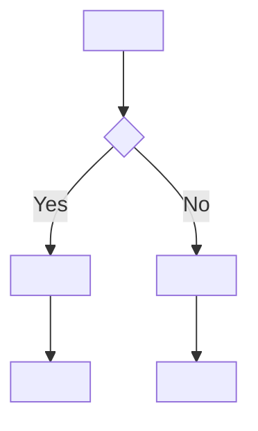

<!-- @spec FR-003: Flow spec template — ../../../../../.specs/features/027-define-flow-screen-spec-grammar/spec.md#fr-003 -->

<!-- TEMPLATE: Copy this file as <target>/flow-ui-contract/flows/<flow-slug>.md -->
<!-- Replace all <placeholder> values. Remove all <!-- TEMPLATE: comments. -->

---
flow: <flow-slug>
title: "<Human-readable flow title>"
status: draft
priority: P1
mockups:
  - <product_parent_subview>
surfaces:
  - mobile
source:
  - <target>/project-profile.md
  - <target>/01-exploration.md
generated_at: "<YYYY-MM-DD>"
---

# Flow Spec: <Human-readable flow title>

- **Project:** <slug>
- **Flow ID:** FLOW-<NAME-UPPER>
- **Status:** draft
- **Primary Actor:** <e.g. "Registered practitioner", "Anonymous visitor">
- **Surfaces:** <e.g. mobile, web>
- **Mockups:** <comma-separated mockup filenames without extension>
- **Source:** <comma-separated source paths>

## Input

<!-- Summary of the brainstorm brief section that motivated this flow.
     Why does this flow exist? What user need or business goal does it address?
     2-4 sentences. -->

<Brief narrative from project exploration and market research.>

## User Scenarios & Testing

### P1 — <Title of the primary scenario>

- **As a** <primary actor>
- **I want** <goal or action>
- **So that** <benefit or outcome>

**Priority reason:** <Why is this P1? What breaks if this flow doesn't work?>

**Independent test:** <How can a tester verify this scenario in isolation, without the full system?>

```gherkin
Feature: <Flow title>
  Scenario: <Happy path title>
    Given <precondition>
    When  <user action>
    Then  <expected outcome>
    And   <secondary outcome>

  Scenario: <Error/edge path title>
    Given <alternate precondition>
    When  <user action>
    Then  <expected error or alternate outcome>
```



<!-- Add ### P2 — <title> and ### P3 — <title> blocks if applicable. Same format. -->

## Acceptance Criteria

- **AC-001** — <Testable criterion 1. Specific, unambiguous, binary pass/fail.>
- **AC-002** — <Testable criterion 2.>
- **AC-003** — <Testable criterion 3.>

<!-- Numbering: sequential, no gaps (AC-001, AC-002, AC-003...). -->

## Functional Requirements

- **FR-001** — <Requirement 1. Each FR must cite at least one AC, e.g. "(mappe AC-001)".>
- **FR-002** — <Requirement 2. (mappe AC-002)>
- **FR-003** — <Requirement 3. (mappe AC-001, AC-003)>

<!-- Every AC must be cited by at least one FR. No FR may cite a non-existent AC. -->

## Key Entities

- **<Entity name>** — <1-sentence definition. What is this thing in the domain?>
- **<Entity name>** — <definition.>

## Edge Cases

- <Edge case 1: what unusual condition could occur and how should the system behave?>
- <Edge case 2.>
- <Edge case 3.>

## Success Criteria

- **SC-001** — <Measurable success metric 1. Quantified where possible.>
- **SC-002** — <Measurable success metric 2.>
