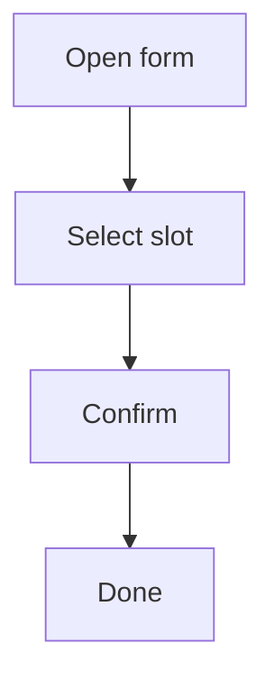

# Flow Spec: Reserve a session

- **Project:** demo
- **Flow ID:** FLOW-BOOKING
- **Status:** draft
- **Primary Actor:** Registered client
- **Surfaces:** mobile
- **Mockups:** mobile_booking_form
- **Source:** —

## Input

Client booking flow. [NEEDS CLARIFICATION]

## User Scenarios & Testing

### P1 — Client books a session

- **As a** registered client
- **I want** to book a session
- **So that** I can meet the practitioner

**Priority reason:** Core flow.

**Independent test:** Book a session end to end.

```gherkin
Feature: Booking
  Scenario: Happy path
    Given the client is authenticated
    When the client confirms a slot
    Then a booking is created
```



## Acceptance Criteria

- **AC-001** — The form shows available slots.
- **AC-002** — A confirmation is shown. [NEEDS CLARIFICATION]

## Functional Requirements

- **FR-001** — Fetch slots from API. (mappe AC-001) [NEEDS CLARIFICATION]
- **FR-002** — Show confirmation. (mappe AC-002) [NEEDS CLARIFICATION]

<!-- Total: 4 [NEEDS CLARIFICATION] markers — exceeds limit of 3 -->

## Key Entities

- **Booking** — A reservation.

## Edge Cases

- Slot becomes unavailable.

## Success Criteria

- **SC-001** — 95% success rate.
