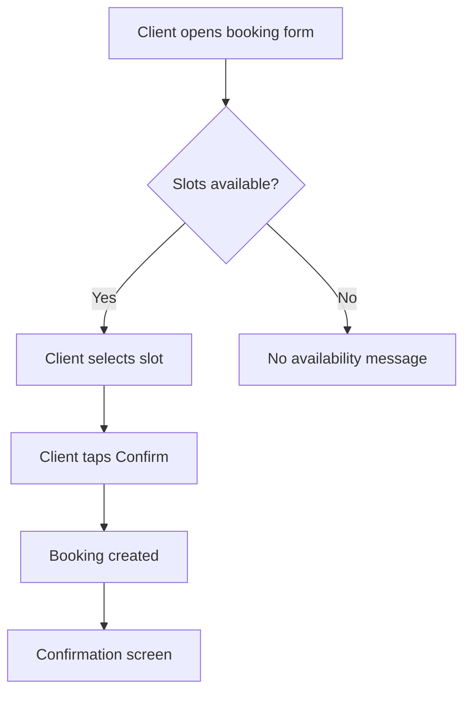

# Flow Spec: Reserve a session

- **Project:** demo
- **Flow ID:** FLOW-BOOKING
- **Status:** draft
- **Primary Actor:** Registered client
- **Surfaces:** mobile
- **Mockups:** mobile_booking_form, mobile_booking_confirmation
- **Source:** projects/demo/project-profile.md

## Input

Clients need to book sessions with practitioners. The booking flow covers slot selection, confirmation, and payment.

## User Scenarios & Testing

### P1 — Client books a session successfully

- **As a** registered client
- **I want** to select a time slot and confirm a booking
- **So that** I can reserve time with a practitioner

**Priority reason:** Core revenue flow — without it the product has no value.

**Independent test:** Select an available slot, confirm, verify booking appears in client dashboard.

```gherkin
Feature: Session booking
  Scenario: Client books an available slot
    Given the client is authenticated
    And the practitioner has available slots
    When the client selects a slot and taps "Confirm"
    Then a booking is created
    And the client receives a confirmation

  Scenario: No slots available
    Given the practitioner has no available slots
    When the client opens the booking form
    Then the client sees "No availability" message
    And cannot submit the form
```



## Acceptance Criteria

- **AC-001** — The booking form displays available time slots for the selected practitioner.
- **AC-002** — The client can confirm a booking by tapping the Confirm button.
- **AC-003** — A confirmation screen is shown after successful booking.

## Functional Requirements

- **FR-001** — The form fetches available slots from the API on load. (mappe AC-001)
- **FR-002** — Tapping Confirm submits a POST /bookings request. (mappe AC-002)
- **FR-003** — On success response, the app navigates to the confirmation screen. (mappe AC-003)

## Key Entities

- **Booking** — A time-bound reservation between a client and a practitioner.
- **Slot** — An available time window offered by a practitioner.

## Edge Cases

- Slot becomes unavailable between load and confirmation — show conflict error.
- Network timeout during confirmation — show retry option.

## Success Criteria

- **SC-001** — 95% of booking attempts complete without error under normal conditions.
- **SC-002** — Confirmation screen appears within 2 seconds of form submission.
