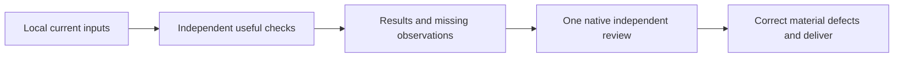

# Plan — Review led checks

## Inputs and decisions

Inventory before implementation: explicit workspace/project selectors; optional theme path; current contract JSON; active ui.pen regions/context/bboxes; semantic IDs; available actual tree; malformed/missing files; changed/retargeted inputs; dependent versus independent checks; warning/error/info severities; failed comparison score; no runtime/build/visual observations; producer result; postflight cleanup refusal; explicit historical profile/authority requests; existing skill callers and public docs; concurrent work and installed consumers.

Use one read-only command rather than adding delivery modes or modifying C51 verdicts. Existing producer APIs, runtime adapters, schemas, approval history and historical reports stay compatible. The normal report never certifies delivery. Ordinary standalone read-only validators skip Doctor; explicit C51 requests keep governance. Preserve ordinary producer results on postflight cleanup refusal, report separately on stderr; do not weaken cleanup authorization.

## Modules and verification

| Convention / responsibility | Decision / location | Verification / exception |
|---|---|---|
| Thin CLI, typed boundaries | `cli_checks.py` wires args to `review_checks.py`; frozen result records, existing issue payload contracts | CLI JSON and domain checks; heterogeneous existing JSON uses Any only at adapter payload boundaries |
| Current immutable snapshot | Reuse `InputReader` confined reads and final recheck; share parsed pen/expected data, no persistent user-input cache | mutation, invalid JSON, outside/symlink paths and byte-stable repeated check |
| Small module responsibilities | Reuse existing pure validators and comparator; extend expected export with optional preloaded document | regressions plus actual mismatch and independent-check continuation |
| Errors and bounded work | Capture expected input/shape errors per check; no subprocess, UI runtime or network; finite fixed check inventory | malformed input test, no fabricated PASS, unchanged input files |
| Compatibility and cleanup | `_dispatch` bypasses health only for non-C51 read-only commands; postflight cleanup finding on stderr except historical run | focused governance tests and existing C51/Doctor/cleanup suites |
| Documentation and skill discovery | Current SKILL entries select review workflow; archive former exact body in certification.md; current README/integration docs point to policy | inspect all current callers; historical text tests use archived bodies |
| Naming and locale | Python snake_case per language delta, Markdown kebab-case; English developer diagnostics per repository policy | ruff/mypy and independent review; no localization framework introduced into existing English diagnostic CLI |
| Data model | Ephemeral JSON report, no DB/tables/migration; fields below | no SQL/engine/nullability work applicable |
| Measurement | Compare historical run vs check on copied demo; record durations, inputs and completed check counts | no broad speed claim from partial historical run; clean wheel CLI smoke outside checkout |

Report dictionary: kind=`penflow-check-report`, version=1, workspace=resolved caller workspace, certified=false, review_status=required; checks ordered list of {name, status PASS/FAIL/NOT_RUN/ERROR, exit_code int or null only for NOT_RUN, issues array, details object}; limitations lists unverified rendered UI/runtime interactions and input/dependency gaps. Top-level exit is 1 if any executed check fails/errors, otherwise 0; status FINDINGS if checks fail or are not run, otherwise CHECKED. Neither zero exit nor CHECKED is delivery approval. Optional inputs retain absence, never default to invented captures. No stored state, report ID, clock or registry certificate.

## Delivery and rollback

Create migration guidance with scope/limitations, isolated wheel check and comparison measurements. Run pytest, ruff and mypy appropriate to changes; preserve all failures for review. Dispatch one fresh native reviewer without implementer history, correct material findings and ask the same reviewer to inspect corrections. Update mappings/registry/changelog and commit only these files. No installation, global sync, Atlas/runtime/SDK edit, publish or merge. Rollback selects the prior commit/package and explicit historical commands; retain artifacts and concurrent consumer changes.

## Targeted fix — contract-only semantic export

Actual inputs: explicit project boundary, strict v2 contract.json bytes and output path/previous output ownership. The transformation reads no .pen, theme, UI mapping, temporary run or renderer. Canvas health/hygiene therefore cannot veto this producer. Preserve existing project path resolution and shared lifecycle writer lock; skip Doctor/canvas/run-allocation only for ordinary export-semantic-tree. Historical run/C51 and every other producer keep their current path.

| Requirement / convention | Scoped decision | Verification |
|---|---|---|
| FR-003 input relevance / modular boundary | cli_governance routes only this contract producer through existing confined paths and lock; no global disable | Real subprocess CLI with invalid canvas and untidy metadata succeeds on valid contract |
| Validated source / honest result | Reuse strict contract→semantic engine and existing semantic validator; validate before publication | Invalid contract/output never published; source changes detected |
| Data ownership / bounded I/O | New semantic_export boundary reuses InputReader and atomic JSON writer; reject source aliases, symlinks/nonregular/hardlinks, non-JSON or foreign/invalid existing output | Outside-project/alias/foreign output preserved; own semantic output can regenerate |
| Independent history | No cleanup/reconciliation or canvas mutation for this pure projection; shared writer lock remains | No canvas rewrite/managed runs/index mutation; other governed producers remain blocked when appropriate |
| Compatibility / proportional verification | Keep legacy Python write_semantic_tree API and historical run unchanged; targeted CLI/export/governance/contract suites and same reviewer follow-up | Existing export interfaces, installed-wheel smoke and required CI |

No Atlas, private SDK, installed environment, binding, dependency or global instruction mutation. New output ownership is limited to the selected semantic artifact, not a project-wide certification.
