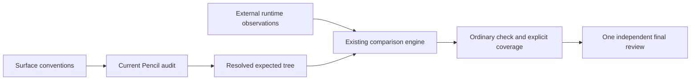

# Plan — Rendered design conventions

## Inventory

Inputs: canonical ui.pen/lifecycle, surface/platform/contract metadata, convention source references, profile rules/overrides/reasons, variables/theme, semantic/pencil IDs, role/intent/variant, fixed/fill/hug boxes, spacing/typography/icons/images, optional design-layout, independent actual tree, units/coordinates/viewport/zoom/DPR/state/variant, missing/contradictory data, masks, containment/concurrent changes, historical/private consumers.

## Convention mapping and decisions

| Requirement/convention | Module and concrete choice | Verification/exception |
|---|---|---|
| FR-001 validated config, units, explicit result | design_profile.py pure resolver/audit; sourced bundled selection, precise reasoned overrides; unknown context never PASS | profile variations, contradiction, missing metrics |
| FR-002 reuse modules | pen.py/tree.py diagnostic regions separate strict active selection; review_checks.py independent fallback; token lint reuse | lifecycle error does not suppress independent diagnostics |
| FR-003/004 separation/substitution | rendered_measurements.py normalizes copies via existing geometry/styles; compare.py extends existing joins | fixed/fill/hug, viewport/state/variant, units/zoom/coords, ratios/masks |
| FR-005 external I/O boundary | examples/adapters/web-rendered independent DOM producer/owned fixture | real bad→corrected browser captures, no design import in adapter |
| FR-006 discoverability | current repository skills/README/migration guide | docs tests, clean installed wheel; no private SDK replacement |
| Validation/errors/logs | strict JSON boundaries, stable diagnostic codes, InputReader confinement/recheck, no core subprocess/network | malformed/nonfinite/symlink/no-write tests |
| Resource ownership | bounded local snapshots; external demo closes browser, removes temporary builds | runner cleanup and regression |
| Naming/docs | Python snake_case, Markdown kebab-case, English developer diagnostics | ruff/mypy; existing English diagnostic CLI retained without unrelated i18n rewrite |
| Data-model gate | ephemeral JSON only, no database/schema engine | structured validation tests; SQL/tenancy/index/migration not applicable |

## Validation and delivery

Focused pytest then full python -m pytest, ruff, mypy, build, installed-wheel smoke. One fresh native independent final reviewer receives request/spec/plan/conventions/diff and actual evidence; same reviewer checks material fixes. Update mappings/registry, commit scoped changes, publish PR and merge after CI subject to protections. Prepare private Atlas port files/contracts, never install or replace its SDK package.

## Targeted fix — exact typography scale handoff

Gap: a valid compact13px source passes the desktop profile rule but fails the independent default token scale. Inventory: optional profile typography object, exact positive finite numeric scale/source label, theme font-size declarations, defaults, malformed/missing profile/source, source confinement/recheck and independent diagnostics.

| Convention / requirement | Scoped decision | Verification |
|---|---|---|
| Validated configuration / FR-001,002 | Add optional typography.font_size_scale + source to design-profile schema; reject empty/duplicate/nonpositive/nonfinite/nonnumeric values | Real native .pen normal-check regression, direct boundary tests |
| One resolved configuration | Resolve profile once before design lint; pass exact values to existing lint_tokens fontsize_scale | 13 accepted, actual offscale still fails, no default/theme union |
| Explicit contradiction | Compare theme-declared font sizes with profile exact set; report typography-scale findings, never silently add them | Theme outside exact set fails even if source label valid |
| Independent results / compatibility | Missing scale retains current theme-plus-default behavior; invalid profile reports ERROR and independent checks use an explicitly labelled legacy fallback | Invalid/absent/no-write/CLI and existing review checks |
| Traceable workflow | Agent reads real conventions/exclusions and materializes surface, role/variant rules and exact scale once; sources hashes are provenance only | Current docs/skill references and same-reviewer correction follow-up |

No adapter/runtime/schema-C12/private consumer change. Reuse unchanged real-browser evidence; run affected pure/check/doc suites, lint/types, packaging smoke and required remote CI. Source authority remains existing repository-owned skills; no global projection write.
