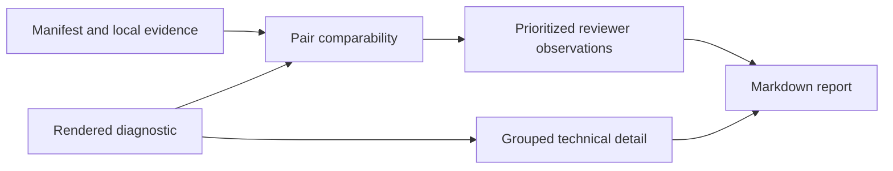

# Plan — Visual alignment report

## Summary

Add a standalone `visual-alignment` Markdown command over an explicit review manifest, existing PNG captures and full rendered diagnostic output.

## Technical context and convention mapping

| Requirement / convention | Location and decision | Verification |
|---|---|---|
| FR-001, explicit types, validated input, bounded I/O | Bundled JSON Schema validates structure and enum values. `visual_alignment.py` uses existing confined regular-file reads with a per-file bound, strict JSON and change detection. A missing value is distinct from a conflicting one. Verify image dimensions against the declared logical viewport and scale. | CLI regressions for incompatible dimensions, absent capture, invalid input, traversal and unchanged sources. |
| FR-002, input ownership and errors | Report ranks explicit reviewer observations by priority. It verifies local citations and optional JSON pointers, labels provenance and withholds unsupported recommendations. `visual_alignment_markdown.py` owns English/French labels and escaping. | Regression with more than three items, unavailable evidence and rejected approval. |
| FR-003, reuse and compatibility | Adapt `compare_rendered` or the `check` envelope read-only. Fold technical findings by families and codes, preserving the source link and all item details. CLI registration adds a read-only verb with stdout output. | Validate both input formats, compare original bytes and run existing suite. |
| FR-004, diff semantics | Compare before/after identities and require distinct observed capture bytes. Keep both sets of evidence and their cited interpretation. | Matching and incompatible before/after tests plus a local fold replay. |
| FR-005, bounded ownership | Runtime is Python only. The consumer manifest and output stay local and refer to external evidence by path. | Replay existing captures and receipts. Check source bytes, package build and CLI version. |

## Implementation plan

1. Define the versioned manifest, source readers, pair and evidence checks.
2. Add a localized Markdown report and register the read-only CLI command.
3. Add focused regressions and replay the local example. Run package validation and independent review.

## Constitution check

No external capture engine, new dependency, new diagnostic gate, writes to evidence or database change. Continue to use canonical artifacts from the existing comparators.

## Testing strategy

Use temporary contained evidence directories for CLI tests. Run the three local cases against existing saved results and screenshots. Run pytest, Ruff, mypy, build validation and one independent final review.

## Risks

- Rendered tree diagnostics do not carry screenshot judgments or authentic build identity. Report copy declares the association, displays provenance and retains machine findings.
- Shared consumer evidence can change. Use bounded reads and recheck consumed bytes before emitting the report.
- A declared after pair can reuse the same image. Test digest rejection and verify the local replay with separate design/runtime PNG sources.
