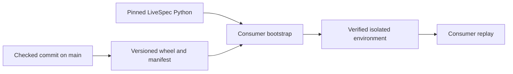

# Plan — Managed consumer release

## Summary

Publish a new stable version only after main passes CI. Resolve the release on normal consumer runner startup with the project's pinned Python, then use a verified independent environment for Penflow commands.

## Technical Context

| Requirement and conventions | Location and decision | Verification |
|---|---|---|
| FR-001 / build provenance and bounded workflow | Main-only release job after existing CI jobs. Exact checkout and locked runtime dependencies. Compare version and publish a draft only after smoke. | Build test and real GitHub release. |
| FR-002 / typed input boundaries and narrow CLI | Standalone bootstrap validates the pin, GitHub release/tag/asset metadata, package version and provenance. Emit one structured receipt. | Invalid registry inputs and isolated package probe. |
| FR-003 / idempotency and failure isolation | Cache by base runtime, version and immutable release identity. Serialize activation, publish the receipt last and clean only an incomplete environment created by the invocation. | Old to new, repeat and failure tests. |
| FR-004 / product boundary | Existing consumer runner calls bootstrap once at startup. The project and private runtime remain independently managed. | Reuse evidence, run one real capture and call the new report through the returned interpreter. |

## Constitution Check

The installer is outside the library CLI and runs with the standard library and uv. Publication jobs, consumer evidence and the pinned LiveSpec runtime have separate ownership.

## Implementation Plan

1. Produce a checked release and its dependency manifest.
2. Verify and activate the release locally.
3. Wire the consumer entry point and verify the isolated Python and no-op repeat.

## Testing Strategy

Test malformed packages and release inputs, cache setup/reuse and failures locally. Run the full Python suite, build and isolated smoke. Confirm release provenance, installed version, runner evidence and historical pin on the Mac.

## Risks

Release discovery requires GitHub access. A failed download or invalid asset stops startup before the runner writes evidence. Cache identity keys preserve previously installed releases for explicit replay.
