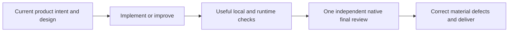
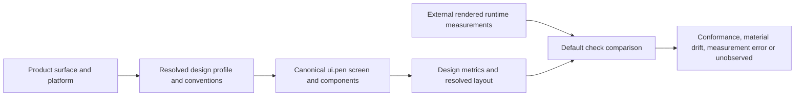

# Review led Penflow workflow

This is the normal workflow for Penflow, flow-ui-contract and Mockup Factory. Existing diagnostic commands keep their real verdicts; their certification protocols have no automatic veto over delivery.

- Read the actual project conventions and relevant design references. Keep the current product contract, actions, permissions, state changes and outcomes truthful. A missing approval ledger does not prevent reading current requirements.
- Use `penflow check --target <workspace> --project <consumer-project-root> --json` to collect available local diagnostics. The workspace/project are explicit caller choices; no Git repository, Doctor receipt, approval history, native receipt packet or build manifest is needed for this read-only command. Capture the command, exit, concise findings and limitations.
- `check` reads current `ui.pen`, optional `flow-ui-contract/contract.json`, `theme.css`, `design-profile.json`, `design-layout.json` and `actual-ui-tree.json`. It derives expected structure in memory, never trusts a stale expected file, and runs independent checks after a failure. Profile and rendered-measurement diagnostics run by default; there is no extra enable flag. It writes no files. Missing files/dependencies are `NOT_RUN`; available inputs with missing measurement/profile coverage are `NOT_OBSERVED`, with null exit when no failure was found. Malformed inputs are `ERROR`, never PASS. Exit 1 means at least one executed diagnostic failed or errored; exit 0 means those executed checks found no warning/error. Either may include unavailable observations. `certified: false` and `review_status: required` always apply.
- Source JSON must be valid and contained in the selected project; input changes during a run remain findings. Metadata/history/doc projections are not prerequisites for independent checks. Existing contract validators still reject real action/permission/state defects.
- Local checks consume measurements; they do not launch a renderer or observe the application themselves. Structural `compare-tree` remains available for existing unqualified actual trees. For measurement-qualified trees, `compare-rendered` performs the structural comparison after coordinate/style normalization; the raw-coordinate `compare-tree` diagnostic is explicitly not run to avoid false drift. Rendered comparison requires an external runtime capture with measured geometry, computed styles, viewport and explicit units/coordinates/scale. A CSS declaration, copied expected tree or unqualified actual tree is not runtime measurement. Capture metadata describes the measurement contract; it is not independent proof of freshness, build identity or interaction. Inspect the real rendered UI and exercise behavior when relevant. Essential missing observations remain explicitly unverified for review.
- Run proportionate product tests/builds/typing/lint/runtime observations. Reuse passing results while their relevant inputs remain unchanged. Fix real product defects; report unrelated warnings, unavailable tooling and legacy debt without restarting every check or the whole feature pipeline. Do not fabricate PASS, hide errors, delete failing tests, weaken requirements or copy expected results into runtime evidence.
- Dispatch one fresh generic native reviewer without implementer conversation history. Give it the user request, accepted decisions, spec/plan, applicable conventions, full diff, relevant existing code and actual check results, including failures/unavailable observations. The host's response is the review record; no JSON verdict, model certificate, hash chain or review ingestion is needed. Use this same reviewer for correction follow-up, not a new whole-feature review.
- The reviewer judges correctness, acceptance coverage, architecture, file placement, maintainability and concrete security/data risks. Only material defects, essential missing observations with material risk, missing authority or unresolved functional decisions delay delivery. Carry minor/pre-existing findings as disclosed follow-ups. If native review is unavailable, state it; do not substitute self-approval.
- Preserve exact consumer project boundaries and ambiguous-write/deletion protections. Prefer the selected `ui.pen` canvas; keep real active/draft/archive revisions intact. Read-only validators inspect explicit files without Doctor hygiene. Producers still use their existing confined Doctor/managed-run boundary; `doctor --fix` is explicit setup/repair, never an automatic certificate retry loop. On an ordinary producer, a refused postflight cleanup is a separate `penflow-cleanup-finding` JSON line on stderr; product stdout/exit remain intact and unproven data stays untouched. Historical `run` retains its old cleanup behavior.
- Update specs/mappings/changelog/registry as ordinary confined documents; mark Implemented after independent review accepts the behavior. Commit, publish, merge or install only within user authorization. Never silently upgrade an installed consumer or resume a mission under another policy.

## Conventions, design and rendered measurements

- Resolve the product surface and platform before designing controls. Use explicit contract screen surface metadata or the workspace profile; do not infer a dense desktop application from `web` alone. Read the project's actual convention sources, including platform exclusions, and record source references. A web-based desktop cockpit uses the applicable web/product rules; an iPhone hit target does not define its compact visual control size. Landing headings and CTAs use their own profile.
- Select the profile once in the workspace; subsequent normal `check` calls apply it automatically. `design-profile.json` minimally contains `{"version":1,"surface":"desktop-app","platform":"web"}`. Supported surfaces are `desktop-app`, `web-page`, `landing` and `mobile`; supported platforms are `web`, `ios` and `android`, with mobile policies for native platforms. An exact, consistent contract `screens[].surface` may select a supported purpose; a generic `web` surface cannot. Rules cover measurable dimensions, spacing and typography with explicit selectors and source references. Product exceptions need a scoped override and a reason. Missing context, unresolved tokens or unmeasurable geometry remain unobserved; profiles do not automatically judge aesthetic quality.
- Keep the canonical `ui.pen` and stable semantic IDs. Reconcile the exact screen, state, variant and viewport with runtime capture. Use the source Pencil node identity when explicit revision/variant selection is needed; never guess the active screen after an ambiguous lifecycle finding. Independent region and token diagnostics continue and state their scope; metadata ambiguity remains visible.
- Measure fixed geometry against the same logical viewport. Source `fill_container` / `fit_content` values are layout constraints, not numeric zero: supply resolved native layout observations when their rendered dimensions are needed. Preserve parent-relative versus screen-relative coordinates, CSS/logical versus physical pixels, zoom and device-pixel ratio. Unsupported or contradictory observations are measurement errors, not relaxed tolerances.
- Capture actual DOM/native bounds and computed styles independently of the design. Check control/image proportions, typography, padding and layout where observed; a missing style or dimension cannot establish compliance. Keep source design, runtime measurements and limitations available to the final reviewer. Read [the rendered Web adapter guide](adapters/web-rendered.md) for the external capture contract and executable owned demonstration.

## Automatic parallel work in one canvas

- Automatically delegate ready, independent preparation, design and verification tasks to several native subagents when useful, using the actual available slots and tool access. Do not wait for a separate delegation request, impose a fixed agent count or create redundant workers. If subagents are unavailable, continue the authorized work with the available agent.
- Keep one product canvas and reuse existing screens. Assign each writer explicit named screens, frames or components in that same document; disjoint regions may be mutated in parallel. Do not impose a universal single-editor operator or create another `.pen` to give each agent its own file.
- Give each agent a self-contained brief: repository, current workflow, exact canvas/file access, owned regions and task, applicable conventions, restrictions, acceptance criteria and expected evidence. State that other agents are working and that their edits must be preserved. Confirm current document/node identity before editing; do not infer access from another agent's connection.
- Maximize useful parallel work among authorized, connected agents. If a subagent cannot access this canvas, delegate independent preparation, scripts, design or review to it; a connected agent can apply its prepared edits to the owned regions after checking current state. This is a configuration-specific fallback, not a universal single-operator rule or a reason to open a substitute canvas. Report the access limit without blocking the goal or promising shared access everywhere.
- Assign an integration owner to coordinate shared nodes, variables and reusable components, plus changes affecting several owned regions. Sequence conflicting edits through that owner while independent region edits and preparers/verifiers continue in parallel. Re-read shared state before integration; do not overwrite concurrent work with an older whole-document copy.
- After a mutation timeout, read the affected region before any replay. Coordinate saves through the exposed mechanism, then verify the intended changes and actual persistence; one agent's successful call is not proof that every concurrent edit was saved. Respect precise tool refusals and permissions; report the affected capability without inventing success or blocking unrelated work.
- Assemble the actual changes and check outcomes for one common independent final review, including each agent's limitations. Do not add a review per worker, agent-count gate or certification receipt. Read [the editor observations and user-confirmed shared-canvas provenance](pen-dev-editor-observations.md) for what was observed and what Julien confirmed; do not repeat a plugin capability test as a prerequisite.

## Native design semantics and coverage

- Normal check expands bounded local reusable components, nested instances and explicit descendant/property/children replacements in memory. Source bytes stay unchanged. Library definitions are audited as design inputs, not required runtime screens. Semantic identities are preserved; ambiguous or duplicate mappings need correction rather than guessed renaming. Imported-library references remain explicitly unobserved; missing/cyclic/non-reusable local targets are errors.
- Native frame layout defaults to horizontal; explicit `layout: none` allows absolute children. Numeric source positions under a layout parent do not prove rendered positions. Native text `lineHeight` multiplies `fontSize`; text growth modes determine which dimensions are intrinsic. Native variables use inherited/default theme axes and the last matching value. Read [the native format contract](https://docs.pen.dev/for-developers/the-pen-format) before interpreting these source properties.
- Resolved native layout must name the current `ui.pen` byte SHA-256 in `source_sha256`, use parent-relative logical coordinates, and include matching source node IDs. It cannot override a contradictory fixed source constraint. This is observation binding, not a certificate workflow. Unresolved references/styles remain unobserved even when bounds exist.
- Observed runtime content overflow remains a named review observation: scrolling, deliberate cropping and unwanted truncation need product interpretation. Matching boxes never silently establish content visibility. Screenshots and human judgment still cover aesthetic hierarchy and rendering artifacts.

## Existing canvas and editor connection

- Keep one canonical design file per consumer product, normally `penflow/ui.pen`. Add features, journeys and active/draft/archive regions inside that document. Do not create another `.pen` per feature or redraw existing screens to recover a connection. A separate product or an explicit multi-document request is a different scope.
- Before editing, inspect the existing editor and confirm the intended file through the plugin. Pass that exact `filePath` to calls. If another document answers, return to the intended existing view; do not mutate the wrong canvas. Opening another editor is not a connection repair for the current document.
- With the integrated `pen-dev` tools, `open_editor` returning `Opened` confirms a view request, not a connected editor. Confirm with `get_app_state` and a targeted read. After a connection timeout, retry the state read once as documented before opening another view of the same file. Never treat a mutation timeout as proof that nothing happened: reconcile through a read before replaying it.
- A failed connection to a newly requested view does not establish that the existing product canvas or the entire goal is blocked. Inspect the intended existing document first and continue independent authorized work. Escalate only the specific capability that remains unavailable after the bounded checks; do not stop the mission merely because an unnecessary second document did not connect. Explicit refusals still apply to their actual scope.
- Several documents can be addressable in one chat; this is not permission to split a product's design. A connected editor can respond with its chat in the background and displays asleep. A newly requested view may still need to be displayed once to connect. Report the actual document, observations and limitation instead of claiming that the user must keep watching the chat.
- Use native `Get`/bounds observations for geometry. A plugin `TakeScreenshot` result containing `ImageContent` can be preserved by decoding its returned image bytes into a local PNG; record the actual image dimensions and render scale. A reduced overview is not a 1× measurement. If `Export` acknowledges export without producing an observable file, report that export limitation and use available qualified screenshots/bounds rather than requiring an invisible export. Technical synthetic raster fixtures test decoding/measurement mechanics; they are not aesthetic fidelity references.
- Keep editor readback and disk persistence separate. A successful mutation/readback or an unchanged file digest alone does not prove that the latest edit was saved. Inspect available save evidence without creating substitute canvases or inventing success. Read [the measured editor observations](pen-dev-editor-observations.md) for the tested scope and remaining uncertainty. This is operator guidance, not a new certification gate.

## Historical diagnostics

Only when the user explicitly requests certification or an old diagnostic, read [the retained C51 guide](verification-workflow.md) and the invoked skill's `certification.md`. Existing `run` (C42), `run --strict-closure` (C47), `run --profile design|implementation` (C51), `validate-report --required-profile`, `authority`, native receipt and visual-evidence validators retain their real commands, exit codes and historical interpretation. A historical FAIL/BLOCKED remains FAIL/BLOCKED. Do not run these automatically to advance review led delivery, and do not mix their reports with `penflow-check-report`.

Read [migration and rollback guidance](review-led-migration.md) before adopting a new package or changing an active consumer. Read [the adapter guides](adapters/README.md) for external runtime capture; Penflow never starts browsers, simulators, Xcode or application builds.
