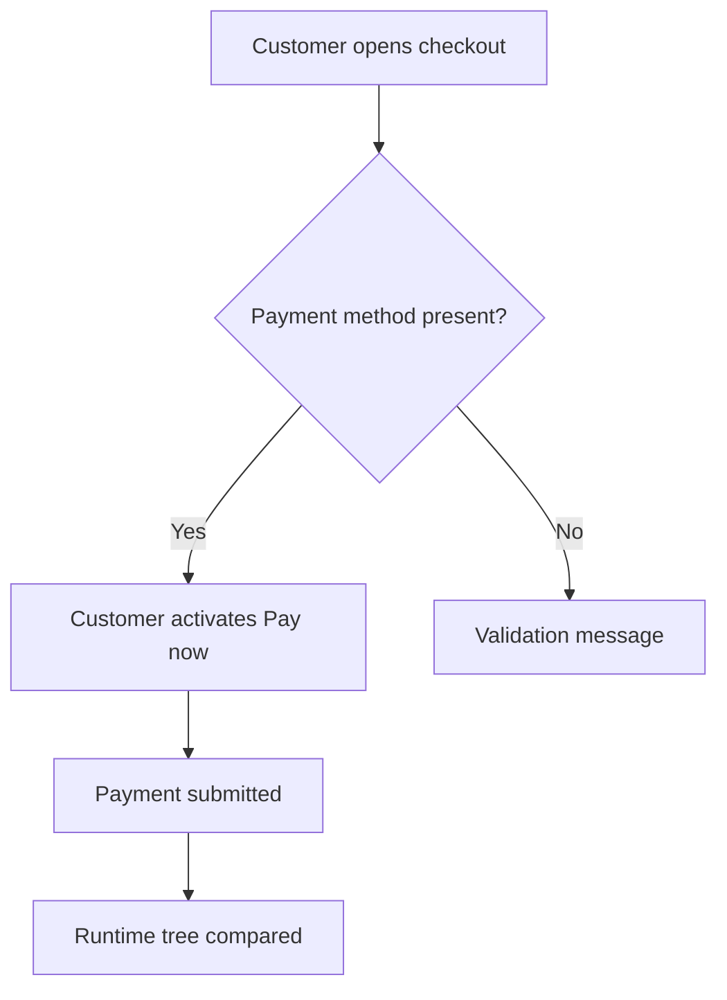

# Flow Spec: Checkout

- **Project:** penflow-full-demo
- **Flow ID:** FLOW-CHECKOUT
- **Status:** draft
- **Primary Actor:** Returning customer
- **Surfaces:** web
- **Mockups:** checkout
- **Source:** examples/full/project-profile.md

## Input

The full demo proves the Penflow forward chain from product-level flow specs to runtime comparison artifacts. The checkout flow is intentionally small so every generated artifact stays inspectable.

## User Scenarios & Testing

### P1 — Customer pays from checkout

- **As a** returning customer
- **I want** to review my order and submit payment
- **So that** I can complete checkout with confidence

**Priority reason:** This is the shortest flow that exercises data, validation, side effects, code handoff, and runtime comparison.

**Independent test:** Regenerate the demo directory, validate each artifact, and confirm the compare report remains PASS.

```gherkin
Feature: Checkout
  Scenario: Payment succeeds
    Given the customer has an order summary and a selected payment method
    When  the customer activates "Pay now"
    Then  the payment is submitted
    And   the runtime tree matches the Pencil contract

  Scenario: Payment method is missing
    Given the customer has no selected payment method
    When  the customer activates "Pay now"
    Then  the checkout blocks submission with a validation message
```



## Acceptance Criteria

- **AC-001** — The demo includes flow and screen Markdown specs.
- **AC-002** — The semantic tree, enriched Pencil file, expected tree, code IR, actual tree, and reports regenerate deterministically.
- **AC-003** — The generated actual tree validates and the compare report passes.

## Functional Requirements

- **FR-001** — Provide flow and screen specs under `flow-ui-contract/`. (mappe AC-001)
- **FR-002** — Generate semantic, Pencil, expected, code IR, actual, compare, review, and fix artifacts from local commands. (mappe AC-002)
- **FR-003** — Keep the actual tree external-runtime-shaped while validating through `validate-actual --schema`. (mappe AC-003)

## Key Entities

- **Checkout** — The screen where a customer reviews order details and submits payment.
- **Payment** — The business action triggered by the primary checkout CTA.

## Edge Cases

- Missing payment method prevents submission.
- Runtime implementation omits a semantic node and compare-tree reports the gap.

## Success Criteria

- **SC-001** — The full demo chain exits 0 for validation and comparison commands.
- **SC-002** — Regenerating the chain produces byte-identical artifacts for the same output path.
